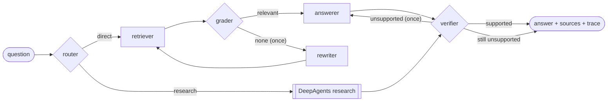
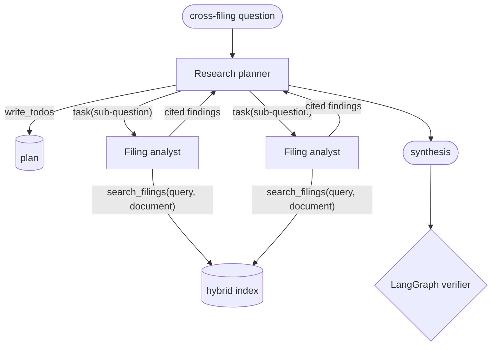

# Virallens AI Engineer Assignment

Two deliverables over five US securities-law filings ([`data/`](data/)): a multi-agent RAG system
(Q1) and a study of a domain-specific embedder (Q2). The brief is in [`README.txt`](README.txt);
design decisions and their evidence are in [`docs/DESIGN.md`](docs/DESIGN.md).

| | What | Run |
|---|---|---|
| **Q1** | Multi-agent RAG — LangChain, LangGraph, DeepAgents; Groq with OpenRouter fallback | [`main.py`](main.py), [`Dockerfile`](Dockerfile) |
| **Q2** | Domain-specific embedder vs. a baseline, with clustering and similarity metrics | [`notebooks/q2_domain_embedder.ipynb`](notebooks/q2_domain_embedder.ipynb) |

The filings: the Supreme Court's *Macquarie v. Moab* opinion (`macquarie`), the petitioners' and the
United States' opposing briefs in *Facebook v. Amalgamated Bank* (`fb-petitioners`,
`fb-united-states`), the *Last Atlantis v. AGS* district-court opinion (`last-atlantis`), and the
SEC's complaint against Chiueh and Upright Financial (`sec-v-chiueh`).

## Quick start

```bash
uv sync                                   # Python 3.12, locked dependencies
cp .env.example .env                      # add GROQ_API_KEY (OPENROUTER_API_KEY optional)
uv run python main.py ingest              # parse, chunk and index the filings (no API key)
uv run python main.py ask "Are pure omissions actionable under Rule 10b-5(b)?"
uv run python main.py eval-retrieval      # retrieval metrics (no API key)
uv run python main.py eval-e2e --out eval/results.json
```

With Docker — the index and embedding model are built into the image:

```bash
docker build -t virallens-rag .
docker run --rm --env-file .env virallens-rag ask "How does Macquarie bear on the Facebook case?"
```

## Q1 — Multi-agent RAG

### Agent roles

| Agent | Model | Job |
|---|---|---|
| Router | qwen3.8-27b | `direct` for questions about a fact, holding or allegation; `research` only to compare parties or connect cases |
| Retriever | — | Hybrid BM25 + dense search fused by Reciprocal Rank Fusion; top 6 passages |
| Grader | qwen3.8-27b | Keeps the retrieved passages that help answer the question |
| Rewriter | qwen3.8-27b | Rewrites the query in the filings' vocabulary when nothing relevant came back (once) |
| Answerer | gpt-oss-120b | Answers from the passages only, citing each sentence (`[macquarie:29]`); revises its draft when the verifier objects |
| Verifier | code + qwen3.8-27b | Checks the answer cites only passages it was given, then that each claim is backed by its citation |
| Research planner | gpt-oss-120b | DeepAgents: plans sub-questions (`write_todos`) and delegates each (`task`) |
| Filing analyst | gpt-oss-20b | DeepAgents sub-agent: answers one sub-question with `search_filings` |

### LangGraph flow



Both loops are bounded. An answer still unsupported after one revision is returned marked
`NOT VERIFIED` with the failing claims; a question with no relevant passages says so.

### DeepAgents flow



The analyst is the planner's only delegate and the only agent that can search, so every passage
behind a research answer is recorded and verified. Model calls are capped per agent.

### Approach

- **Preprocessing** removes the page furniture pypdf extracts (ECF stamps, running heads, tables of
  contents) and repairs hyphenation. **Chunking** follows each filing's heading structure and keeps
  the heading path and page range on every chunk, so answers cite pages.
- **Retrieval** fuses BM25, for exact strings like `Item 105` and `Rule 10b-5(b)`, with dense
  embeddings, for paraphrase. Embeddings run locally (fastembed), so indexing needs no API.
- **Rate limiting and fallback.** Each model has a client-side request limiter at its provider's
  limit, and the roles are spread over three Groq models, each with its own token quota. Invalid
  model output is retried once; the Groq SDK retries rate limits and server errors, waiting out
  per-minute limits; what still fails, a rejected key or persistent invalid output moves the call to
  OpenRouter when a key is set; anything else raises.

### Results

Retrieval on 15 hand-written questions (`eval/questions.json`, k = 6):

| Retriever | hit@1 | hit@6 | MRR |
|---|---|---|---|
| BM25 | 0.67 | 0.87 | 0.767 |
| Dense | 0.47 | 0.87 | 0.624 |
| **Hybrid** | **0.73** | **0.93** | **0.800** |

Full pipeline on the Groq free tier ([`eval/results.json`](eval/results.json), which records the
passages each answer cites): **15/15 answered, route accuracy 1.00, all 15 answers verified, 14/15
cite a passage on an expected page**, 89,669 tokens in total (run on 2026-10-19 by a revision
whose output lacked two fields added since; rerunning regenerates it). The miss, a research
question, cites other argument pages of the two briefs than those listed as expected. The research path is not
deterministic: the same question was returned `NOT VERIFIED`, with its unsupported claim listed, on
another run. The OpenRouter fallback was also exercised live, with Groq made to fail, on both a direct
and a research question. Details and caveats: [`docs/DESIGN.md`](docs/DESIGN.md#end-to-end-evaluation).

## Q2 — Domain-specific embedder

Three encoders are compared on the same held-out pages: the general-purpose `all-MiniLM-L6-v2`
(baseline, 384-d), TF-IDF + SVD fit on the training pages (LSA, 128-d), and MiniLM fine-tuned
self-supervised on the training pages with a 128-d head (domain). Pages are held out in 3-page
blocks, and any held-out chunk sharing a 100-character span with training text is dropped. Labels
are used only for scoring. Three seeds, CPU, reproducible.

Topic separation on 72 held-out chunks (mean over seeds):

| | baseline | LSA | domain |
|---|---|---|---|
| Silhouette (cosine) | 0.191 | 0.256 | **0.307** |
| KMeans ARI | 0.307 | **0.769** (± 0.33) | 0.462 (± 0.14) |
| kNN purity (k = 5) | 0.956 | **0.982** | 0.962 |
| Similarity gap | 0.144 | 0.206 | **0.226** |
| Retrieval MRR (held-out answers) | 0.774 | **0.853** | 0.695 |

Fine-tuning improves topic separation over the baseline, but the classical LSA model fit on the same
279 chunks is stronger on most metrics: what separates these filings is largely vocabulary. ARI
depends on KMeans, which splits the large topic on some seeds, hence its spread. The
fine-tuned model is worse at question-to-passage retrieval than the baseline it started from, and no
model separates the two opposing Facebook briefs. Code is split by stage in
[`src/virallens/embedder/`](src/virallens/embedder/); figures, metrics and the full discussion are in
the notebook; resources referred to are in [`research/resources.md`](research/resources.md).

## Repository layout

```
main.py                    Q1 command line
src/virallens/common/      PDF cleaning, chunking, catalogue, settings, evaluation questions
src/virallens/rag/         Q1: models and call policy, retrieval, agents, prompts, graph, research, evaluation
src/virallens/embedder/    Q2: data, train, embed, cluster, plots, study (python -m virallens.embedder)
notebooks/                 Q2 notebook (executed)
research/                  Q2 outputs and resources
eval/                      evaluation questions, end-to-end results, model-comparison script
docs/DESIGN.md             design decisions, evidence and limitations
tests/                     test suite (no API calls)
```

## Development

```bash
uv sync --extra research   # adds the Q2 stack (torch, sentence-transformers, scikit-learn)
uv run pytest              # no API calls; Q2 tests are skipped without the research extra
uv run ruff check . && uv run ruff format --check . && uv run pyright
```

Tests use the real corpus, real BM25 and real embeddings, with scripted agents in place of the LLM
calls; run them from the repository root after `main.py ingest` has cached the embedding model.
`eval/compare_models.py` compares Groq models per role and writes `eval/model_comparison.json`;
budget its Groq tokens as described in `docs/DESIGN.md`.
CI ([`.github/workflows/ci.yml`](.github/workflows/ci.yml)) runs lint, type checks and both test
suites.
